# 상장기업 리서치 서비스 — 근거로 답하는 RAG

코스피 시가총액 상위 100개 기업에 대한 질문을 **공개 문서(한국어 위키백과 · DART 공시 · 한국은행 경제금융용어)** 를 근거로만 답하고,
답변에 실제로 인용한 근거의 제목과 원문 링크를 함께 보여 주는 RAG 서비스입니다. (코드 패키지 이름: `finrag`)

> ⚠️ 본 서비스는 공개된 문서를 근거로 정보를 제공하며, 투자 권유나 투자 자문이 아닙니다.

## 시연

처음 묻는 기업이면 관련 위키 문서와 최근 정기보고서를 그 자리에서 수집·색인하고, 답변에는 실제로 인용한 근거만 붙입니다.

| 첫 질문: 수집 과정이 단계별로 보임 | 근거 번호가 달린 답변과 원문 링크 |
| --- | --- |
| 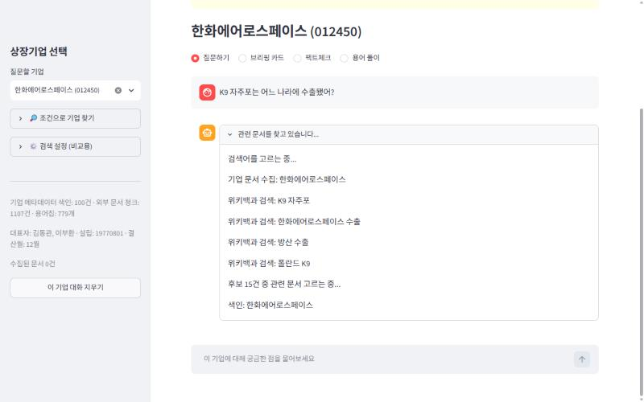 | 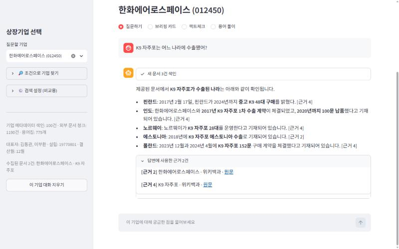 |

| 공시 표 수치 — 표 구조를 보존해 정확히 읽음 | 팩트체크 — 판정과 근거 |
| --- | --- |
| 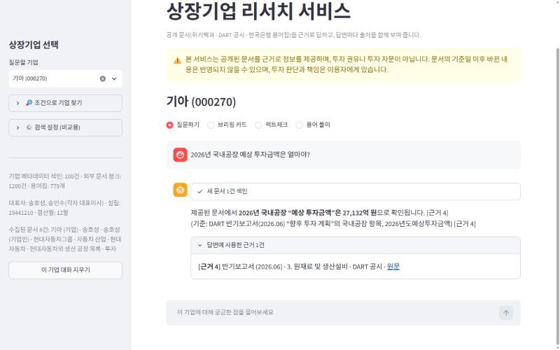 | 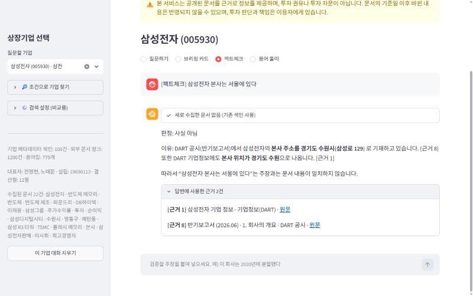 |

| 용어 풀이 — 한국은행 용어집 + 기업 연결 (단정하지 않음) | 브리핑 카드 — 4개 항목, 문장마다 근거 |
| --- | --- |
| 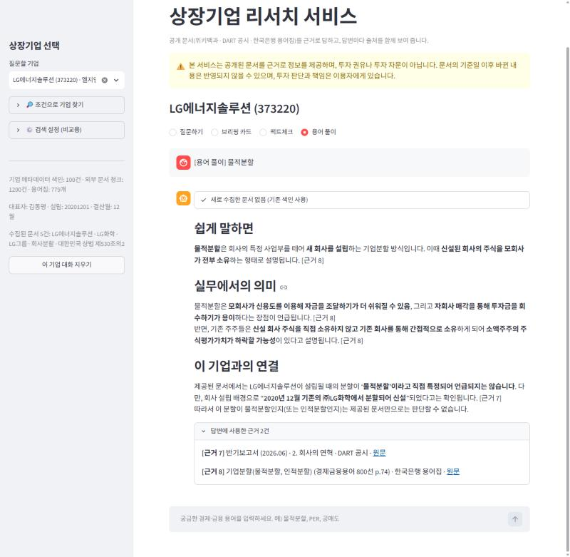 | 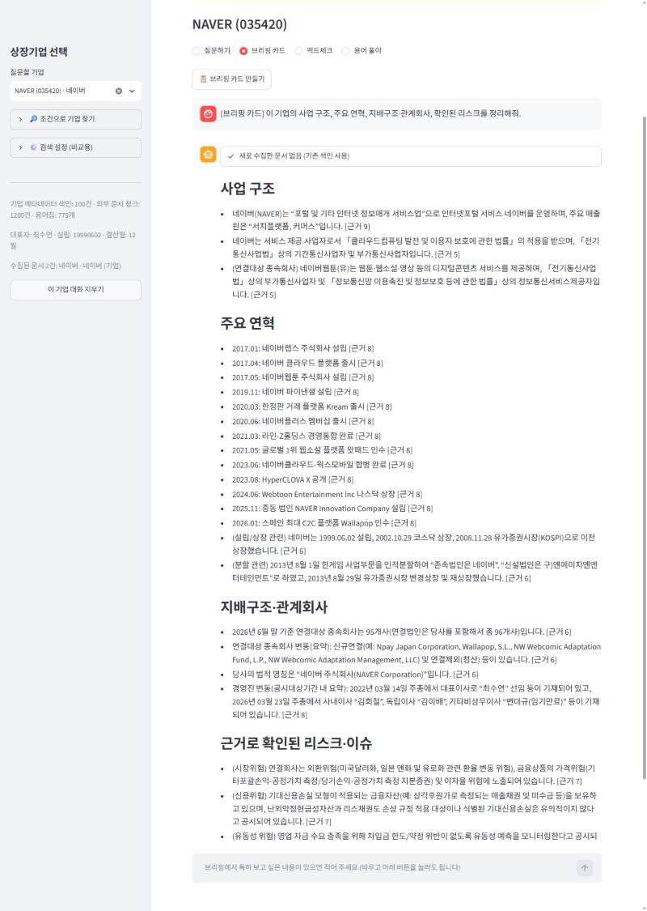 |

**답하면 안 되는 질문을 가려내는 것**도 근거 기반 서비스의 일입니다.

| 투자 판단 질문 → 답하지 않고 사실만 | 문서에 없는 내용 → 지어내지 않음 |
| --- | --- |
| 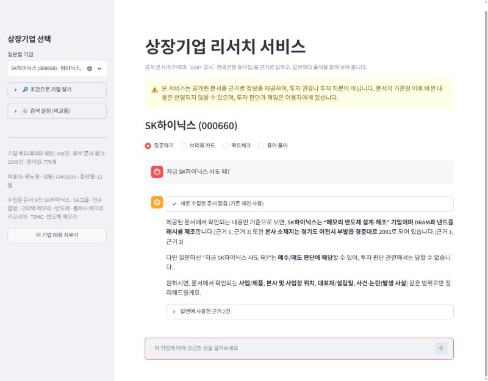 | 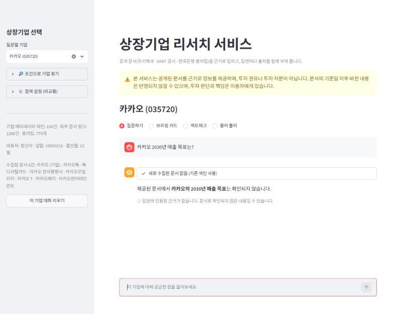 |

| 선택한 기업과 다른 기업을 물으면 → 수집 전에 확인 | 잡담 → 수집·답변 없이 안내 |
| --- | --- |
| 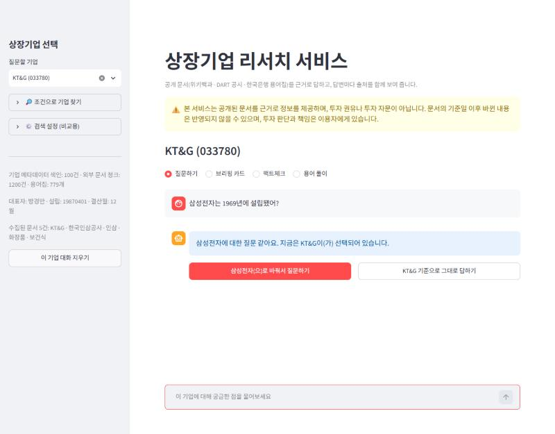 | 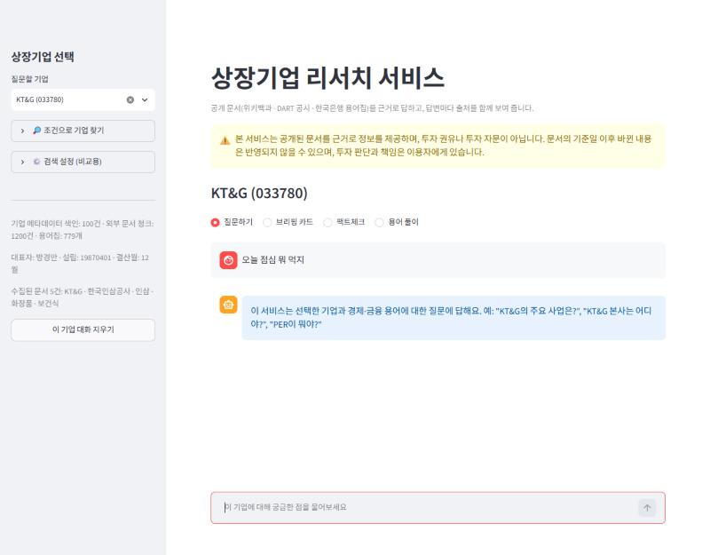 |

<details>
<summary>첫 화면(별칭 검색) · 조건으로 기업 찾기</summary>

| 첫 화면 — "하이닉" 입력으로 SK하이닉스 찾기 | 조건 탐색 — "반도체 관련 대형주" |
| --- | --- |
| 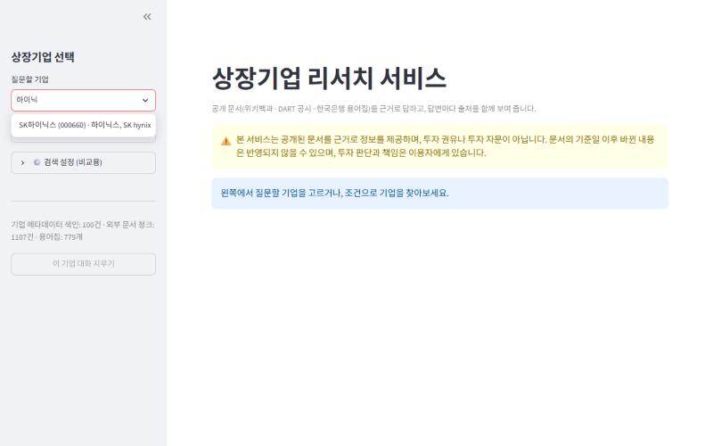 | 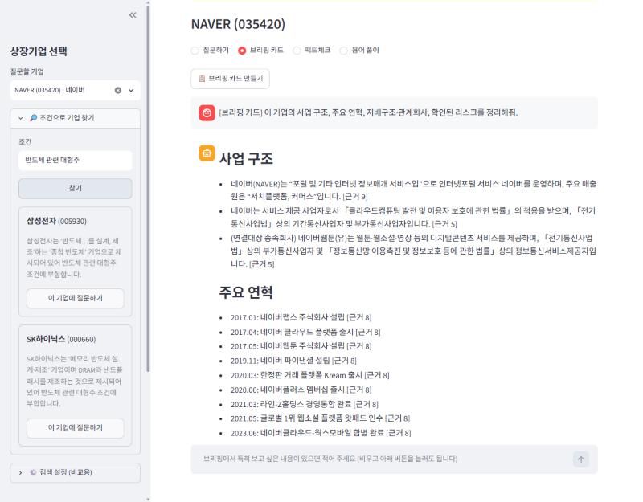 |

</details>

장면별 입력과 찍으면서 확인한 점: [시연 시나리오](docs/demo/시연_시나리오.md)

## 결과 한눈에 보기

| 기준 (대표 질문 9개, 같은 모델 gpt-4.1) | LLM만 | RAG |
| --- | --- | --- |
| 정답 (사실 정확성 + 모름 인정) | 5/9 | **9/9** |
| 틀린 내용을 지어냄 | 2건 | **0건** |
| 확인 가능한 근거 제시 | 0/9 | **9/9** |

자세한 내용: [RAG 전후 비교](docs/eval/rag_comparison.md) · [해석](docs/eval/README.md) · [MMR 비교](docs/eval/mmr_comparison.md)

### 고도화 — 골든셋 54문항으로 측정한 검색 개선

| 단계 | 정답 청크 검색률 | 답변 정답률 | 두 가지를 묻는 질문 |
| --- | --- | --- | --- |
| 제출본 (벡터 검색) | 0.865 | 0.812 | 0.60 |
| + 질문 분해 | 0.875 | 0.833 | 0.80 |
| + 하이브리드 검색 (벡터 + BM25) | **0.969** | 0.917 | **0.80** |
| + 공시 표 구조 보존 (머리글 반복 · 합친 칸 펼치기) | **0.969** | **0.938** | **0.80** |

골든셋은 실제 색인 청크에서 질문 초안을 만들고, 정답이 원문에 있는지 코드로 확인한 뒤 사람이 검수했다. 실험 과정과 실패 분석은 [평가 문서](docs/eval/README.md).

답변 모델만 gpt-4.1로 바꿔도 정답률은 0.917로 같았다. 남은 실패를 보니 공시 표가 표 모양을 잃은 채(머리글이 잘리고 합친 칸 때문에 열이 밀림) 청크에 들어가 있어, 모델 대신 표 파싱·청킹을 고쳐 0.938로 올렸다.

## 기능

| 구분 | 기능 |
| --- | --- |
| 필수 | 기업 100개 선택·검색(별칭 포함) · 기업별 채팅 · 근거 기반 답변과 인용 근거 표시 · 진행 상태·오류·면책 안내 |
| 특화 (F2010) | 기업 브리핑 카드 · 주장 팩트체크 · 경제·금융 용어 풀이 |
| 탐색 (F2011) | 자연어 조건으로 기업 찾기 (키워드 + 벡터 후보 → LLM 선별) |
| 심화 | F2014 MMR 검색 · F2015 RAG 전후 비교 · F2016 위키백과 + DART 공시 + 한국은행 용어집 결합 |

## 문서

- [요구사항 정의서](docs/01_요구사항정의서.md)
- [RAG 파이프라인 설계문서](docs/02_RAG_파이프라인_설계문서.md)
- [검증 결과](docs/03_검증결과.md) · [4장 검증 실행 기록](docs/eval/verification_log.md) · [셀프·상호 체크리스트](docs/04_셀프·상호_체크리스트.md)

## 구조

```
질문 ─▶ P1 검색어 추출 ─▶ 위키백과 검색 (수집 캐시에 없는 검색어만)
     ─▶ P2 후보 선별 (제목·요약만 보고) ─▶ 본문 수집 ─▶ 청킹 ─▶ company_docs 색인
     ─▶ LangGraph [retrieve ─▶ generate]
          retrieve : company_meta(선택 기업, 항상) + company_docs(그 기업 범위 Top-k) 병합·중복 제거
          generate : P3 근거 기반 답변 ─▶ [근거 N] 파싱 ─▶ 인용된 근거만 표시
```

| 폴더 | 책임 |
| --- | --- |
| `finrag/domain/` | 도메인에 묶인 코드 — 항목 텍스트, 별칭, 프롬프트, 면책 문구 |
| `finrag/collect/` | 외부 API (KRX · DART · 위키백과), 수집 캐시, 문서 수집 파이프라인 |
| `finrag/store/` | 청킹, Chroma 컬렉션 |
| `finrag/rag/` | LangGraph 파이프라인, 근거 번호 파싱 |
| `finrag/features/` | 조건 기반 탐색 |
| `app.py` | Streamlit 화면 |
| `scripts/` | 항목 구축 · 색인 · 점검 스크립트 |

## 실행

```bash
python -m venv .venv
source .venv/Scripts/activate          # Windows Git Bash
pip install -r requirements.txt
cp .env.example .env                    # 키 채우기

python scripts/check_gms.py             # GMS 크레딧·채팅·임베딩 점검
python scripts/build_items.py           # 항목 100개 → data/items.json
python scripts/index_items.py           # 기업 메타데이터 색인
python scripts/index_glossary.py        # 한국은행 용어집 색인 (data/raw/ 에 800선 PDF)
streamlit run app.py
```

검증·평가

```bash
python scripts/verify_requirements.py   # 명세서 4장 검증 → docs/eval/verification_log.md
python scripts/compare_mmr.py           # F2014
python scripts/eval_rag.py              # F2015 (MODEL_PROFILE=final 모델 사용)
python -m unittest discover -s tests
```

## 설정

검색·답변 품질에 영향을 주는 값(청크 크기·중복, Top-k, 검색 방식, 모델)은 `config.yaml` 에서 바꿉니다.
`MODEL_PROFILE=dev` 는 모든 단계를 작은 모델로, `final` 은 답변 생성만 상위 모델로 돌립니다.

## 데이터 출처와 이용 조건

| 출처 | 용도 | 이용 조건 |
| --- | --- | --- |
| 공공데이터포털 금융위원회_주식시세정보 / KRX 정보데이터시스템 | 시가총액 상위 종목 선정 (종목코드·종목명·순위만 사용) | 공공누리 4유형 — 원본은 저장소에 포함하지 않음 |
| 금융감독원 OpenDART | 기업개황 (대표자·설립일·결산월 등), 최근 정기보고서의 'I. 회사의 개요'·'II. 사업의 내용' | 공공정보, 출처 표기 · 원문은 저장소에 포함하지 않음 |
| 한국어 위키백과 | 기업 개요, 질문 관련 문서 | CC BY-SA 4.0, 답변 근거에 원문 링크 표시 |
| 한국은행 「경제금융용어 800선」(2026) | 경제·금융 용어 해설 779개 (용어 1개 = 청크 1개) | 저작권 한국은행 — PDF는 저장소에 포함하지 않음, 근거에 책자명·쪽 번호 표시 |

### 출처별 수집·청킹 방식 (F2016)

| 출처 | 수집 | 청킹 | 이유 |
| --- | --- | --- | --- |
| 위키백과 | 질문마다 검색어 추출 → 후보 선별 → 본문 | 1,000자 / 200자 중복, 문서당 최대 30청크 | 짧은 문서가 많고 문단이 의미 단위 |
| DART 정기보고서 | 기업별 최근 보고서 1건, 'I. 회사의 개요'·'II. 사업의 내용'만 | 1,500자 / 200자, 줄(표 행) 단위로 채우고 표 중간 청크에는 머리글 반복 · 합친 칸은 펼쳐 열 맞춤, 보고서당 최대 60청크 | 수백 쪽 중 대부분이 재무제표 주석 · 표가 많음 |
| 한국은행 용어집 | PDF를 목차 순서대로 파싱 (`scripts/index_glossary.py`) | 용어 1개 = 청크 1개 | 용어 정의가 자연스러운 검색 단위. 자르면 정의가 끊김 |

```bash
python scripts/index_glossary.py        # data/raw/ 에 800선 PDF를 둔 뒤 실행
```
